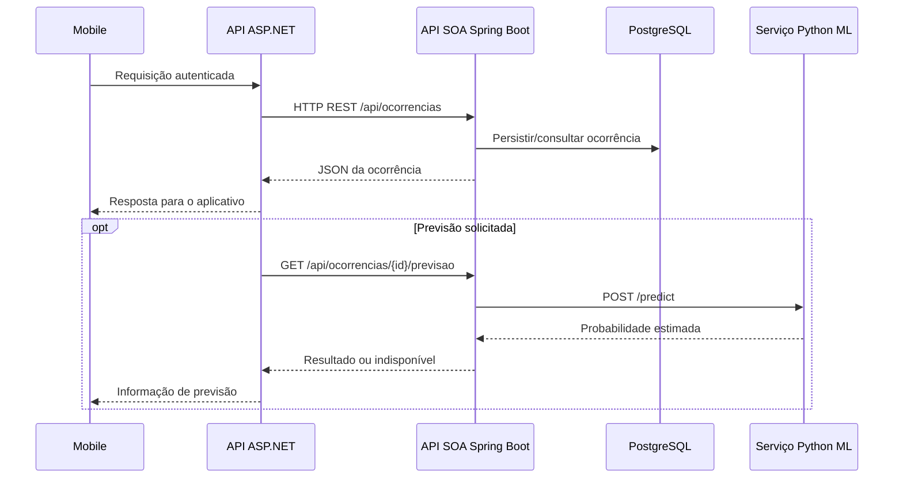

# Alinhamento técnico — integração do grupo

## Mensagem sugerida para o grupo
Pessoal, para separar as responsabilidades, minha proposta é:
- Mobile consome somente a API ASP.NET (C#), como já foi combinado.
- A API ASP.NET chama a API SOA em Java/Spring Boot por HTTP/REST para operações de ocorrências.
- O serviço SOA é responsável pelo domínio de ocorrências, bairros, categorias, confirmações e histórico, com PostgreSQL próprio.
- O módulo de IA/ML será Python, treinado em notebook com dados públicos do SP156. Opcionalmente, exponho um endpoint interno de previsão para o SOA consultar.
- Para o ambiente Linux, teremos PostgreSQL, serviço Java na porta 8080 e, se habilitarmos a inferência, Python/FastAPI na porta 8000. Tudo pode subir por Docker Compose.

Precisamos combinar se o ASP.NET ficará responsável por login/perfis e encaminhará o identificador do morador para o SOA. O banco do SOA não deve ser acessado diretamente pelo C# nem pelo Mobile.

## Diagrama de sequência simplificado


## Contrato de criação da ocorrência
`POST http://<host-soa>:8080/api/ocorrencias`

```json
{
  "titulo": "Poste apagado",
  "descricao": "Luminária sem funcionar há três dias",
  "endereco": "Rua Exemplo, 100",
  "latitude": -23.56,
  "longitude": -46.65,
  "bairroId": 1,
  "categoriaId": 1,
  "moradorId": "id-do-morador-no-sistema-csharp"
}
```

O identificador `moradorId` é um identificador de integração, não autenticação. Em ambiente real, o serviço deve validar a identidade do chamador e a autorização antes de aceitar a operação.
